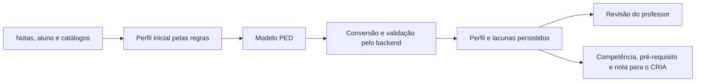

# Contrato do agente PED

Este documento descreve as entradas, as saídas e as responsabilidades do agente
pedagógico **PED**, conforme a implementação atual do backend.

O PED interpreta o desempenho de **um aluno em uma disciplina** e produz uma
leitura pedagógica para revisão do professor. Seu resultado também orienta o
agente CRIA por meio da competência, do pré-requisito e da natureza da lacuna.

## 1. Responsabilidades

| Responsável | O que faz |
| --- | --- |
| Backend, antes do modelo | Consulta as notas, calcula nota geral e variação, seleciona as lacunas e prepara um perfil inicial pelas regras locais. |
| Modelo PED | Escreve o resumo, identifica pontos fortes relativos, detalha as competências, sugere pré-requisitos e intervenções e interpreta as lacunas. |
| Backend, após o modelo | Associa a resposta aos IDs existentes, preserva os resultados numéricos, restringe necessidades às declaradas e persiste o perfil em rascunho. |
| Professor | Revisa, edita ou aprova a leitura pedagógica. |
| CRIA | Usa a competência, a nota e o pré-requisito para definir o foco e gerar questões. |

O PED não calcula nem altera notas, não escolhe novos IDs de lacunas, não gera
questões, não corrige respostas e não diagnostica condições do aluno.



## 2. Informações que o PED precisa receber

### 2.1 Contrato interno da função

A chamada atual é:

```ts
analyzeStudent(input: AnalysisInput, draft: PedagogicalProfile): Promise<PedagogicalProfile>
```

`input` contém os dados de análise. `draft` contém o perfil inicial produzido pelo
backend. A função aceita ainda um parâmetro opcional `model: ModelFn`, utilizado
para substituir a chamada ao modelo, inclusive nos testes.

| Informação | Campo interno | Origem e finalidade |
| --- | --- | --- |
| Identificação do aluno | `input.student.id`, `name`, `classId` | Vincula a análise ao aluno e à turma corretos. |
| Necessidades declaradas | `input.student.declaredNeeds` | Lista fornecida pela escola ou família; limita as interpretações de necessidade. |
| Nome da disciplina | `input.subject` | Contextualiza as competências e os pré-requisitos. |
| Notas por subtópico | `input.scores[]` | Compara desempenho atual, anterior e da turma. |
| Nome legível de cada necessidade | `input.needLabel(id)` | Função do backend para transformar IDs em rótulos no prompt; não é enviada como função ao modelo. |
| Nota geral | `draft.overall` | Resultado numérico já calculado pelo backend. |
| Variação em pontos | `draft.delta` | Comparação já calculada com o período anterior. |
| Lacunas selecionadas | `draft.gaps[]` | Define quais subtópicos o modelo pode detalhar. |
| Perfil inicial | Demais campos de `draft` | Preserva IDs, revisão e textos de reserva quando a resposta do modelo não trouxer uma substituição válida. |

Cada item de `input.scores` tem este formato:

```ts
interface ScoreLine {
  subtopicId: string;
  subtopic: string;
  value: number | null;
  previous: number | null;
  classAverage: number;
}
```

| Campo | Significado |
| --- | --- |
| `subtopicId` | ID do subtópico no banco. |
| `subtopic` | Nome do subtópico. |
| `value` | Nota atual do aluno naquele subtópico, originada de `scores.value`. |
| `previous` | Nota do mesmo aluno e subtópico no período anterior. |
| `classAverage` | Média das notas conhecidas da turma naquele subtópico, no período atual. |

### 2.2 Regras dos dados numéricos

- Notas individuais conhecidas usam a escala de **1 a 100**.
- `null` significa ausência de resultado; não deve ser tratado como nota zero.
- O período atual é o último cadastrado na ordenação do catálogo; o anterior é
  o imediatamente precedente. Os IDs dos períodos não são enviados ao modelo.
- `overall` é a média arredondada das notas atuais conhecidas da disciplina.
- `delta` é `overall` menos a média arredondada das notas anteriores conhecidas.
  Sem notas anteriores, o backend usa zero como valor de reserva para a variação;
  isso não comprova estabilidade do desempenho.
- As regras locais usam `overall = 0` quando não existem notas atuais, mas a
  chamada ao modelo é dispensada nessa situação.
- A implementação de `classAverage` usa zero quando a turma não possui notas
  conhecidas para o subtópico. Esse zero é uma convenção de ausência da média,
  não uma nota observada da turma.

### 2.3 Seleção das lacunas antes de chamar o modelo

O perfil inicial é produzido por `buildProfile`:

1. Considera somente subtópicos com nota atual conhecida.
2. Ordena-os da menor para a maior nota.
3. Seleciona até **duas lacunas**, entre as notas **menores que 70**.
4. Seleciona até dois subtópicos com maior nota como pontos fortes iniciais.
5. Produz resumo, observações, sugestões e pré-requisitos de reserva pelas regras
   da demonstração.

Os pontos fortes são relativos ao próprio aluno: estar entre as maiores notas
não comprova domínio absoluto. O modelo deve evitar essa conclusão sem evidência.

A seleção de alunos para uma avaliação diagnóstica é outra regra: a etapa
pedagógica seleciona alunos com nota **menor que 60** em algum dos subtópicos
escolhidos no diagnóstico. Nota ausente não seleciona um aluno como dificuldade.
Essa seleção é feita pelo backend, não pela resposta textual do modelo.

## 3. JSON efetivamente enviado ao modelo

O backend envia uma mensagem de sistema com as regras do PED e uma mensagem de
usuário com o JSON abaixo. Este exemplo é fictício e segue o formato atual:

```json
{
  "aluno": "Ana",
  "disciplina": "Matemática",
  "necessidades_declaradas": [
    { "id": "dislexia", "nome": "Dislexia" }
  ],
  "nota_geral": 65,
  "variacao": 5,
  "notas": [
    {
      "subtopico": "Lei dos Senos",
      "nota": 90,
      "nota_anterior": 70,
      "media_turma": 80
    },
    {
      "subtopico": "Lei dos Cossenos",
      "nota": 40,
      "nota_anterior": 50,
      "media_turma": 55
    }
  ],
  "lacunas": [
    {
      "subtopico_id": "st-cossenos",
      "competencia": "Reconhecer o caso de dois lados e o ângulo entre eles"
    }
  ]
}
```

No prompt atual, o modelo recebe apenas o primeiro nome do aluno. Os IDs do
aluno e da turma ficam no backend. Embora `ScoreLine` possua `subtopicId`, o
prompt atual envia o nome em `notas` e o ID somente na lista de `lacunas`.

Não são enviados: provas completas, respostas individuais, imagens, tempos de
resolução, idade, série, interesses, região ou histórico de comportamento. O PED
não deve afirmar que observou qualquer uma dessas informações.

## 4. Informações que o modelo PED precisa retornar

O contrato solicitado ao modelo é **um único JSON válido**, em português do
Brasil, sem explicações externas ao JSON:

```json
{
  "resumo": "Ana apresenta seu resultado mais alto em Lei dos Senos. Em Lei dos Cossenos, a nota passou de 50 para 40 e está abaixo da média atual da turma. Vale investigar os conhecimentos de base desse conteúdo.",
  "pontos_fortes": ["Lei dos Senos"],
  "lacunas": [
    {
      "subtopico_id": "st-cossenos",
      "competencia": "Reconhecer quando aplicar a Lei dos Cossenos",
      "pre_requisito": "Calcular potências e identificar o ângulo compreendido entre dois lados",
      "leitura": "tecnica",
      "necessidade": null,
      "observacao": "A nota atual de Ana neste subtópico é 40, inferior à nota anterior de 50. O pré-requisito indicado é uma hipótese a investigar, não uma dificuldade já comprovada por essas notas.",
      "sugestao": "Aplicar exercícios curtos de identificação dos lados e do ângulo, seguidos de revisão de potências."
    }
  ]
}
```

| Campo de saída | Tipo esperado | Conteúdo que deve retornar |
| --- | --- | --- |
| `resumo` | `string` não vazia | Duas ou três frases com a síntese pedagógica baseada nos dados. |
| `pontos_fortes` | `string[]` | Nomes dos subtópicos com desempenho relativamente mais forte. Sem evidência, não inventar pontos fortes. |
| `lacunas` | Array de objetos | Detalhamento das lacunas previamente selecionadas pelo backend. |
| `lacunas[].subtopico_id` | `string` | Exatamente um ID recebido na lista de lacunas; não criar outro ID nem usar o nome no lugar dele. |
| `lacunas[].competencia` | `string` não vazia | Competência que o aluno precisa desenvolver. |
| `lacunas[].pre_requisito` | `string` não vazia | Conteúdo anterior a investigar ou retomar, útil para o CRIA. Não precisa ser um ID de catálogo. |
| `lacunas[].leitura` | `tecnica` ou `necessidade` | Natureza da hipótese pedagógica. |
| `lacunas[].necessidade` | ID declarado ou `null` | ID da necessidade que sustenta a hipótese, apenas quando `leitura = necessidade`. |
| `lacunas[].observacao` | `string` não vazia | Leitura dos resultados, distinguindo evidência de hipótese. |
| `lacunas[].sugestao` | `string` não vazia | Intervenção prática para o professor. |

Para cada lacuna recebida, o agente deve devolver um único detalhamento. Se não
houver lacunas, deve retornar `lacunas: []` e não criar dificuldades artificiais.

### 4.1 Regras sobre necessidades declaradas

IDs reconhecidos pelo projeto: `daltonismo`, `tdah`, `tea`, `dislexia` e
`discalculia`. Para a análise de um aluno, só podem ser usados os IDs presentes
na sua lista `necessidades_declaradas`.

- Com `leitura = tecnica`, retornar `necessidade: null`.
- Com `leitura = necessidade`, retornar um ID efetivamente declarado.
- A declaração de uma necessidade não prova que ela causou a nota baixa.
- Usar linguagem de hipótese, como “pode se relacionar”, sem sugerir diagnóstico.
- As notas agregadas não demonstram, por si só, dificuldade em enunciados longos,
  distração, perda de etapas ou erro de cálculo. Essas afirmações exigiriam dados
  que o prompt atual não contém.

## 5. Retorno da função para os services

O JSON em português é convertido pelo adaptador em um `PedagogicalProfile`.
O modelo não precisa produzir diretamente os nomes camelCase do banco/API.

| Saída do modelo | Campo do backend | Persistência |
| --- | --- | --- |
| `resumo` | `profile.summary` | `student_pedagogical_profiles.summary` |
| `pontos_fortes` | `profile.strengths` | `profile_strengths.strength`, preservando a ordem |
| `subtopico_id` | Correspondência com `gap.subtopicId` | Preserva o subtópico da lacuna existente |
| `competencia` | `gap.competency` | `competency_gaps.competency` |
| `pre_requisito` | `gap.prerequisite` | `competency_gaps.prerequisite` |
| `leitura` e `necessidade` | `gap.reading` | `competency_gaps.reading_kind` e `need_id` |
| `observacao` | `gap.note` | `competency_gaps.note` |
| `sugestao` | `gap.suggestion` | `competency_gaps.suggestion` |

Exemplo do perfil devolvido pela função, após a conversão:

```json
{
  "studentId": "ana",
  "overall": 65,
  "delta": 5,
  "summary": "Ana apresenta seu resultado mais alto em Lei dos Senos. Em Lei dos Cossenos, a nota passou de 50 para 40 e está abaixo da média atual da turma. Vale investigar os conhecimentos de base desse conteúdo.",
  "strengths": ["Lei dos Senos"],
  "gaps": [
    {
      "id": "ana-st-cossenos",
      "subtopicId": "st-cossenos",
      "competency": "Reconhecer quando aplicar a Lei dos Cossenos",
      "prerequisite": "Calcular potências e identificar o ângulo compreendido entre dois lados",
      "reading": { "kind": "tecnica" },
      "note": "A nota atual de Ana neste subtópico é 40, inferior à nota anterior de 50. O pré-requisito indicado é uma hipótese a investigar, não uma dificuldade já comprovada por essas notas.",
      "suggestion": "Aplicar exercícios curtos de identificação dos lados e do ângulo, seguidos de revisão de potências."
    }
  ],
  "review": "rascunho"
}
```

Com leitura de necessidade válida, `reading` usa este formato:

```json
{ "kind": "necessidade", "needId": "dislexia" }
```

### 5.1 Comportamento efetivo do adaptador atual

- Exige um `resumo` não vazio. Sem ele, a análise falha.
- Mantém `studentId`, `overall`, `delta`, IDs das lacunas e estado de revisão do
  perfil inicial. O modelo não substitui esses valores.
- Percorre as lacunas existentes e busca a resposta pelo `subtopico_id`.
  Lacunas inventadas são ignoradas; lacunas omitidas permanecem com os dados
  anteriores. O modelo não altera o conjunto nem a ordem dessas lacunas.
- Usa competência, pré-requisito, observação e sugestão novos quando o texto não
  é vazio; caso contrário, mantém o texto anterior daquele campo.
- Se `pontos_fortes` não for um array não vazio, mantém os pontos fortes iniciais.
- Uma leitura de necessidade só é aceita se o ID estiver declarado pelo aluno.
  Outra combinação vira leitura técnica. Se o objeto da lacuna existe mas omite
  `leitura`, ela também é convertida para técnica.
- O parser tolera alguns formatos imperfeitos de JSON, mas não existe validação
  estrutural completa da resposta do PED. Os tipos, os IDs únicos e o conteúdo
  descritos acima são o contrato que o agente deve cumprir, não garantias de que
  toda resposta incorreta será rejeitada pelo código atual.

## 6. O que o CRIA precisa receber depois do PED

A entrada atual de `createQuestions` é montada pelo backend:

```json
{
  "studentName": "Ana",
  "subject": "Matemática",
  "competency": "Reconhecer quando aplicar a Lei dos Cossenos",
  "score": 40,
  "reading": "tecnica",
  "prerequisite": "Calcular potências e identificar o ângulo compreendido entre dois lados"
}
```

| Campo do CRIA | De onde vem |
| --- | --- |
| `studentName` | Primeiro nome do aluno. |
| `subject` | Nome da disciplina no catálogo. |
| `competency` | Competência da lacuna do subtópico selecionado; sem lacuna correspondente, usa o nome do subtópico. |
| `score` | `scores.value` do aluno, do subtópico e do período atual, consultado pelo backend. Não vem do texto gerado pelo PED nem de `overall`. |
| `reading` | `gap.reading.kind`; sem lacuna correspondente, usa `tecnica`. |
| `prerequisite` | `gap.prerequisite`, informado pelo PED ou pelas regras de reserva. |
| `context` | Texto livre opcional previsto no tipo do CRIA; não é preenchido pelo fluxo automático atual. |

No fluxo automático atual, o backend escolhe o subtópico de menor nota entre os
`diagnostic.subtopicIds` e encontra a lacuna pelo mesmo `subtopicId`. O perfil
geral do PED pode conter lacunas de outros subtópicos da disciplina; isso não
autoriza gerar itens fora dos subtópicos selecionados para o diagnóstico.

O CRIA volta ao pré-requisito quando as três condições são atendidas:

1. `reading = tecnica`;
2. existe `prerequisite`;
3. `score < 60`.

Nos outros casos, o foco é a competência atual. A nota que acompanha esse foco
continua sendo a do subtópico original; não é uma nota medida do pré-requisito.

O CRIA exige `score` numérico entre 1 e 100. No fluxo automático, notas ausentes
recebem um valor interno de reserva de 100 para a seleção, evitando classificar
ausência como dificuldade. Esse valor não é uma nota real nem deve ser descrito
como evidência pedagógica.

**Estado do endpoint na cópia consultada:**
`GET /api/v1/diagnostics/:id/creator-context` filtra os gaps para
`diagnostic.subtopicIds`, mas sua implementação atual não acrescenta `score`
aos gaps. O fluxo automático do CRIA obtém a nota diretamente das consultas do
backend. Um consumidor externo desse endpoint precisa que a integração também
forneça a nota e o período correspondente; não deve substituir essa nota por
`overall`. Este documento registra o estado observado, sem alterar a API.

## 7. Execução, revisão humana e comportamento em falha

- Sem chave configurada ou com `AGENTS_MODE=regras`, o backend mantém as regras
  locais e não chama o modelo PED.
- A análise por modelo não roda quando não existe nenhuma nota atual conhecida.
- Perfis editados ou aprovados pelo professor não são sobrescritos pelo PED.
  O service verifica o estado antes da chamada e novamente antes de salvar.
- O PED pode enriquecer perfis em segundo plano no startup e após novos
  resultados, além de participar da etapa pedagógica de um diagnóstico.
- No diagnóstico, alunos selecionados cujo perfil ainda tem o resumo das regras
  podem receber a análise do modelo antes da montagem dos planos individuais.
- Se o modelo falhar, o service registra a falha e mantém o perfil das regras.
- A função do agente recebe e devolve dados; acesso ao banco e persistência são
  responsabilidades dos services e repositories.

## 8. Arquivos que definem este contrato

| Arquivo | Responsabilidade |
| --- | --- |
| [pedagogical.agent.ts](../backend/src/services/agents/pedagogical.agent.ts) | Tipos de entrada, prompt, JSON de saída e conversão da resposta. |
| [pedagogical.rules.ts](../backend/src/services/agents/pedagogical.rules.ts) | Cálculo do perfil inicial e seleção das lacunas. |
| [pedagogical.notes.ts](../backend/src/services/agents/pedagogical.notes.ts) | Textos e pré-requisitos de reserva da demonstração. |
| [profile.service.ts](../backend/src/services/profiles/profile.service.ts) | Montagem dos dados de análise, chamada do PED e proteção da revisão humana. |
| [profile.repository.ts](../backend/src/repositories/profile.repository.ts) | Persistência dos perfis e das lacunas. |
| [diagnostic-agent.service.ts](../backend/src/services/diagnostics/diagnostic-agent.service.ts) | Seleção dos alunos e montagem da entrada do CRIA. |
| [diagnostic-creator.service.ts](../backend/src/services/diagnostics/diagnostic-creator.service.ts) | Contexto para o CRIA e gravação dos itens gerados. |
| [creator.agent.ts](../backend/src/services/agents/creator.agent.ts) | Entrada do CRIA e escolha do foco no pré-requisito. |
| [domain.ts](../backend/src/types/domain.ts) | Tipos de aluno, perfil, lacuna e diagnóstico. |
| [agents.test.ts](../backend/test/agents.test.ts) | Testes de preservação das notas, das lacunas e das necessidades declaradas. |
