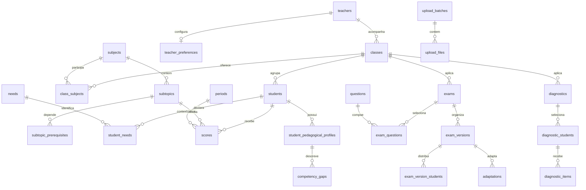

# Estrutura de dados

Referência humana de `schema.db`, baseada nas estruturas e fluxos do frontend. O banco contém **36 tabelas, 3 views e 6 triggers**, com `PRAGMA user_version = 2`. O mapeamento Drizzle está em [src/db/schema.ts](../backend/src/db/schema.ts).

## Convenções

- **PK** identifica a chave primária; uma chave composta só é única considerando todos os seus campos.
- **FK** identifica uma chave estrangeira. Relações compostas são detalhadas após cada tabela.
- IDs são `TEXT`, fornecidos pela aplicação; não há IDs numéricos autoincrementais.
- Listas são representadas por tabelas de associação. `position` preserva a ordem e começa em zero.
- Os campos booleanos são `INTEGER` com `CHECK` para `0` e `1`; o Drizzle os apresenta como `boolean`.
- `REAL` permite valores fracionários. `NULL` representa ausência de informação quando a coluna permite.
- Timestamps são `TEXT`; os defaults gerados pelo banco usam UTC no formato ISO 8601. A aplicação deve manter esse formato ao escrever datas e horas.
- Todas as tabelas físicas são `STRICT`, e a conexão deve ativar `PRAGMA foreign_keys = ON`.
- `CASCADE` remove os registros dependentes; `RESTRICT` impede remover o pai enquanto houver dependentes; `SET NULL` preserva o dependente sem o vínculo.
- `updated_at` tem default apenas na inserção: a aplicação deve informar o novo valor em atualizações.

## Visão dos relacionamentos

O diagrama resume os vínculos principais. As tabelas abaixo detalham todas as relações, incluindo as chaves compostas.

## Dicionário de tabelas

### Cadastros e acessibilidade

#### `teachers`

Professores responsáveis pelas turmas e destinatários das atividades e notificações.

| Campo | Tipo SQLite | Aceita NULL | Default | Chave | Significado |
| --- | --- | --- | --- | --- | --- |
| `id` | `TEXT` | Não | — | PK | Identificador textual do registro. |
| `name` | `TEXT` | Não | — | — | Nome para apresentação. |
| `role` | `TEXT` | Não | — | — | Função apresentada no perfil do professor. |
| `email` | `TEXT COLLATE NOCASE` | Não | — | — | E-mail único com comparação COLLATE NOCASE. |
| `created_at` | `TEXT` | Não | `strftime('%Y-%m-%dT%H:%M:%fZ', 'now')` | — | Data e hora de criação em UTC. |

Chave primária: `id`.

- Unicidade adicional: `email`.
- Validação: `length(trim(name)) > 0`.

#### `teacher_preferences`

Preferências de leitura, acessibilidade e aparência de cada professor.

| Campo | Tipo SQLite | Aceita NULL | Default | Chave | Significado |
| --- | --- | --- | --- | --- | --- |
| `teacher_id` | `TEXT` | Não | — | PK, FK | Professor associado. |
| `motion` | `TEXT` | Não | `'sistema'` | — | Preferência de animações. |
| `font` | `TEXT` | Não | `'padrao'` | — | Fonte padrão ou de leitura. |
| `spacing` | `TEXT` | Não | `'padrao'` | — | Espaçamento padrão ou confortável. |
| `theme` | `TEXT` | Não | `'claro'` | — | Tema claro ou escuro. |
| `sidebar_collapsed` | `INTEGER` | Não | `0` | — | Se a barra lateral está recolhida. |

Chave primária: `teacher_id`.

- FK `(teacher_id)` → `teachers(id)`; exclusão: `CASCADE`.
- Validação: `motion IN ('sistema', 'reduzir', 'completo')`.
- Validação: `font IN ('padrao', 'leitura')`.
- Validação: `spacing IN ('padrao', 'confortavel')`.
- Validação: `theme IN ('claro', 'escuro')`.
- Validação: `sidebar_collapsed IN (0, 1)`.

#### `subjects`

Disciplinas da BNCC, como Matemática e Ciências.

| Campo | Tipo SQLite | Aceita NULL | Default | Chave | Significado |
| --- | --- | --- | --- | --- | --- |
| `id` | `TEXT` | Não | — | PK | Identificador textual do registro. |
| `name` | `TEXT` | Não | — | — | Nome para apresentação. |

Chave primária: `id`.

- Validação: `length(trim(name)) > 0`.

#### `subtopics`

Habilidades da BNCC de uma disciplina, usadas nas questões, notas e diagnósticos. O `id` é o código oficial (`EF09MA13`), e os dados vêm de `src/db/seed/data/bncc/`.

| Campo | Tipo SQLite | Aceita NULL | Default | Chave | Significado |
| --- | --- | --- | --- | --- | --- |
| `id` | `TEXT` | Não | — | PK | Identificador textual do registro. |
| `subject_id` | `TEXT` | Não | — | FK | Disciplina associada. |
| `name` | `TEXT` | Não | — | — | Nome para apresentação. |
| `short` | `TEXT` | Não | — | — | Rótulo curto para heatmaps e etiquetas. |
| `position` | `INTEGER` | Não | `0` | — | Campo `ordem` da BNCC: qualquer subconjunto ordenado por ele dá uma sequência de estudo válida. |
| `unit` | `TEXT` | Não | `'Outros conteúdos'` | — | Unidade temática; agrupa as colunas do heatmap. |
| `knowledge_object` | `TEXT` | Não | `''` | — | Objeto de conhecimento. |
| `description` | `TEXT` | Não | `''` | — | Texto da habilidade na BNCC. |
| `years` | `TEXT` (JSON) | Não | `'[]'` | — | Anos escolares em que a habilidade é trabalhada. |
| `keywords` | `TEXT` (JSON) | Não | `'[]'` | — | Termos usados na busca de habilidades. |
| `level` | `INTEGER` | Não | `0` | — | Profundidade no grafo de pré-requisitos. |

Chave primária: `id`.

- Unicidade adicional: `id, subject_id`.
- FK `(subject_id)` → `subjects(id)`; exclusão: `RESTRICT`.
- Validação: `length(trim(name)) > 0`.
- Validação: `position >= 0`.
- Validação: `length(trim(unit)) > 0`.
- Validação: `years` e `keywords` são arrays JSON.
- Validação: `level >= 0`.
- Índice `subtopics_subject_idx`: `(subject_id, position)`.

#### `subtopic_prerequisites`

Pré-requisitos diretos de cada habilidade; os indiretos saem de percorrer o grafo.

| Campo | Tipo SQLite | Aceita NULL | Default | Chave | Significado |
| --- | --- | --- | --- | --- | --- |
| `subtopic_id` | `TEXT` | Não | — | PK, FK | Habilidade que depende do pré-requisito. |
| `prerequisite_id` | `TEXT` | Não | — | PK, FK | Habilidade de base. |

Chave primária: `subtopic_id, prerequisite_id`.

- FK `(subtopic_id)` e `(prerequisite_id)` → `subtopics(id)`; exclusão: `CASCADE`.
- Validação: `subtopic_id != prerequisite_id`.
- Índice `subtopic_prerequisites_prerequisite_idx`: `(prerequisite_id)`.

#### `periods`

Períodos letivos utilizados para notas e gráficos de evolução.

| Campo | Tipo SQLite | Aceita NULL | Default | Chave | Significado |
| --- | --- | --- | --- | --- | --- |
| `id` | `TEXT` | Não | — | PK | Identificador textual do registro. |
| `name` | `TEXT` | Não | — | — | Nome para apresentação. |
| `position` | `INTEGER` | Não | `0` | — | Posição na lista; ordenação começa em zero. |

Chave primária: `id`.

- Validação: `length(trim(name)) > 0`.
- Validação: `position >= 0`.

#### `classes`

Turmas associadas a um professor, escola, nível de ensino e ano.

| Campo | Tipo SQLite | Aceita NULL | Default | Chave | Significado |
| --- | --- | --- | --- | --- | --- |
| `id` | `TEXT` | Não | — | PK | Identificador textual do registro. |
| `teacher_id` | `TEXT` | Não | — | FK | Professor associado. |
| `name` | `TEXT` | Não | — | — | Nome para apresentação. |
| `level` | `TEXT` | Não | — | — | Nível de ensino. |
| `school` | `TEXT` | Não | — | — | Nome da escola. |
| `year` | `INTEGER` | Não | — | — | Ano letivo. |
| `grade` | `INTEGER` | Sim | `NULL` | — | Ano escolar (1 a 9) que delimita as habilidades oferecidas; sem valor, vale toda a disciplina. |

Chave primária: `id`.

- FK `(teacher_id)` → `teachers(id)`; exclusão: `RESTRICT`.
- Validação: `length(trim(name)) > 0`.
- Validação: `year BETWEEN 1 AND 9999`.
- Validação: `grade IS NULL OR grade BETWEEN 1 AND 9`.
- Índice `classes_teacher_idx`: `(teacher_id, year)`.

#### `class_subjects`

Associação entre turmas e disciplinas oferecidas.

| Campo | Tipo SQLite | Aceita NULL | Default | Chave | Significado |
| --- | --- | --- | --- | --- | --- |
| `class_id` | `TEXT` | Não | — | PK, FK | Turma associada. |
| `subject_id` | `TEXT` | Não | — | PK, FK | Disciplina associada. |

Chave primária: `class_id, subject_id`.

- FK `(subject_id)` → `subjects(id)`; exclusão: `RESTRICT`.
- FK `(class_id)` → `classes(id)`; exclusão: `CASCADE`.
- Índice `class_subjects_subject_idx`: `(subject_id)`.

#### `students`

Alunos e sua turma atual.

| Campo | Tipo SQLite | Aceita NULL | Default | Chave | Significado |
| --- | --- | --- | --- | --- | --- |
| `id` | `TEXT` | Não | — | PK | Identificador textual do registro. |
| `name` | `TEXT` | Não | — | — | Nome para apresentação. |
| `class_id` | `TEXT` | Não | — | FK | Turma associada. |

Chave primária: `id`.

- Unicidade adicional: `id, class_id`.
- FK `(class_id)` → `classes(id)`; exclusão: `RESTRICT`.
- Validação: `length(trim(name)) > 0`.
- Índice `students_class_name_idx`: `(class_id, name)`.

#### `needs`

Catálogo das cinco necessidades reconhecidas pelo frontend.

| Campo | Tipo SQLite | Aceita NULL | Default | Chave | Significado |
| --- | --- | --- | --- | --- | --- |
| `id` | `TEXT` | Não | — | PK | Identificador textual do registro. |
| `label` | `TEXT` | Não | — | — | Nome legível da necessidade. |
| `hint` | `TEXT` | Não | — | — | Orientação curta de acessibilidade. |

Chave primária: `id`.

- Validação: `id IN ('daltonismo', 'tdah', 'tea', 'dislexia', 'discalculia')`.

#### `student_needs`

Necessidades declaradas pela escola ou família para cada aluno. Não representa inferência da IA.

| Campo | Tipo SQLite | Aceita NULL | Default | Chave | Significado |
| --- | --- | --- | --- | --- | --- |
| `student_id` | `TEXT` | Não | — | PK, FK | Aluno associado. |
| `need_id` | `TEXT` | Não | — | PK, FK | Necessidade do catálogo. |
| `position` | `INTEGER` | Não | `0` | — | Posição na lista; ordenação começa em zero. |

Chave primária: `student_id, need_id`.

- FK `(need_id)` → `needs(id)`; exclusão: `RESTRICT`.
- FK `(student_id)` → `students(id)`; exclusão: `CASCADE`.
- Validação: `position >= 0`.
- Índice `student_needs_need_idx`: `(need_id)`.

### Desempenho e questões

#### `scores`

Uma nota por aluno, subtópico e período para o heatmap e a evolução.

| Campo | Tipo SQLite | Aceita NULL | Default | Chave | Significado |
| --- | --- | --- | --- | --- | --- |
| `student_id` | `TEXT` | Não | — | PK, FK | Aluno associado. |
| `subtopic_id` | `TEXT` | Não | — | PK, FK | Subtópico associado. |
| `period_id` | `TEXT` | Não | — | PK, FK | Período letivo associado. |
| `value` | `REAL` | Sim | — | — | Nota de 1 a 100; NULL significa sem resultado. |
| `updated_at` | `TEXT` | Não | `strftime('%Y-%m-%dT%H:%M:%fZ', 'now')` | — | Data e hora da última atualização informada. |

Chave primária: `student_id, subtopic_id, period_id`.

- FK `(period_id)` → `periods(id)`; exclusão: `RESTRICT`.
- FK `(subtopic_id)` → `subtopics(id)`; exclusão: `RESTRICT`.
- FK `(student_id)` → `students(id)`; exclusão: `CASCADE`.
- Validação: `value BETWEEN 1 AND 100`.
- Índice `scores_period_subtopic_idx`: `(period_id, subtopic_id, student_id)`.
- Índice `scores_subtopic_idx`: `(subtopic_id)`.

#### `questions`

Questões do banco ou escritas manualmente, com subtópico e pontuação.

| Campo | Tipo SQLite | Aceita NULL | Default | Chave | Significado |
| --- | --- | --- | --- | --- | --- |
| `id` | `TEXT` | Não | — | PK | Identificador textual do registro. |
| `subtopic_id` | `TEXT` | Não | — | FK | Subtópico associado. |
| `statement` | `TEXT` | Não | — | — | Enunciado da questão. |
| `points` | `REAL` | Não | — | — | Valor máximo da questão; permite frações. |
| `source` | `TEXT` | Não | — | — | Questão do banco ou criada manualmente. |
| `figure` | `TEXT` | Sim | — | — | Referência ou descrição da figura mencionada no enunciado. |
| `alternatives` | `TEXT` (JSON) | Não | `'[]'` | — | Lista ordenada de alternativas (`string[]` na API). |
| `answer_key` | `TEXT` | Sim | — | — | Gabarito: rótulo da alternativa ou resposta textual esperada. |
| `solution` | `TEXT` | Sim | — | — | Resolução explicada da questão. |
| `difficulty` | `TEXT` | Sim | — | — | Dificuldade: `facil`, `media` ou `dificil`; NULL quando não informada. |
| `check_result` | `TEXT` | Não | `'nao_verificavel'` | — | Resultado da checagem: `ok`, `divergente` ou `nao_verificavel`. |

Chave primária: `id`.

- FK `(subtopic_id)` → `subtopics(id)`; exclusão: `RESTRICT`.
- Validação: `length(trim(statement)) > 0`.
- Validação: `points > 0`.
- Validação: `source IN ('banco', 'manual')`.
- Índice `questions_subtopic_source_idx`: `(subtopic_id, source)`.
- Validação: `alternatives` contém JSON válido do tipo array; HTTP e services validam os elementos textuais.
- Validação: `difficulty IN ('facil', 'media', 'dificil')` ou NULL.
- Validação: `check_result IN ('ok', 'divergente', 'nao_verificavel')`.

#### `question_authored_adaptations`

Adaptações previamente escritas de uma questão para uma necessidade específica.

| Campo | Tipo SQLite | Aceita NULL | Default | Chave | Significado |
| --- | --- | --- | --- | --- | --- |
| `question_id` | `TEXT` | Não | — | PK, FK | Questão associada. |
| `need_id` | `TEXT` | Não | — | PK, FK | Necessidade do catálogo. |
| `text` | `TEXT` | Não | — | — | Enunciado adaptado previamente escrito. |
| `why` | `TEXT` | Não | — | — | Justificativa da adaptação. |

Chave primária: `question_id, need_id`.

- FK `(need_id)` → `needs(id)`; exclusão: `RESTRICT`.
- FK `(question_id)` → `questions(id)`; exclusão: `CASCADE`.
- Índice `question_authored_needs_idx`: `(need_id)`.

### Provas e adaptações

#### `exam_groups`

Pastas que organizam as provas de uma turma.

| Campo | Tipo SQLite | Aceita NULL | Default | Chave | Significado |
| --- | --- | --- | --- | --- | --- |
| `id` | `TEXT` | Não | — | PK | Identificador textual do registro. |
| `class_id` | `TEXT` | Não | — | FK | Turma associada. |
| `name` | `TEXT` | Não | — | — | Nome para apresentação. |

Chave primária: `id`.

- Unicidade adicional: `id, class_id`.
- FK `(class_id)` → `classes(id)`; exclusão: `CASCADE`.
- Validação: `length(trim(name)) > 0`.
- Índice `exam_groups_class_idx`: `(class_id)`.

#### `exams`

Provas regulares, disciplina, turma, pasta opcional, data e estado.

| Campo | Tipo SQLite | Aceita NULL | Default | Chave | Significado |
| --- | --- | --- | --- | --- | --- |
| `id` | `TEXT` | Não | — | PK | Identificador textual do registro. |
| `title` | `TEXT` | Não | — | — | Título exibido nas telas. |
| `class_id` | `TEXT` | Não | — | FK | Turma associada. |
| `subject_id` | `TEXT` | Não | — | FK | Disciplina associada. |
| `group_id` | `TEXT` | Sim | — | FK | Pasta opcional da mesma turma. |
| `date` | `TEXT` | Não | — | — | Data de aplicação no formato YYYY-MM-DD. |
| `status` | `TEXT` | Não | `'rascunho'` | — | Estado atual conforme os valores permitidos. |

Chave primária: `id`.

- FK `(group_id, class_id)` → `exam_groups(id, class_id)`; exclusão: `RESTRICT`.
- FK `(class_id, subject_id)` → `class_subjects(class_id, subject_id)`; exclusão: `RESTRICT`.
- Validação: `length(trim(title)) > 0`.
- Validação: `date GLOB '[0-9][0-9][0-9][0-9]-[0-9][0-9]-[0-9][0-9]' AND date(date) IS NOT NULL AND date(date) = date`.
- Validação: `status IN ('rascunho', 'em_adaptacao', 'pronta', 'corrigida')`.
- Índice `exams_class_date_idx`: `(class_id, date DESC)`.
- Índice `exams_group_class_idx`: `(group_id, class_id)`.
- Índice `exams_subject_idx`: `(subject_id)`.

#### `exam_questions`

Questões selecionadas para uma prova e sua ordem de apresentação.

| Campo | Tipo SQLite | Aceita NULL | Default | Chave | Significado |
| --- | --- | --- | --- | --- | --- |
| `exam_id` | `TEXT` | Não | — | PK, FK | Prova regular associada. |
| `question_id` | `TEXT` | Não | — | PK, FK | Questão associada. |
| `position` | `INTEGER` | Não | — | — | Posição na lista; ordenação começa em zero. |

Chave primária: `exam_id, question_id`.

- Unicidade adicional: `exam_id, position`.
- FK `(question_id)` → `questions(id)`; exclusão: `RESTRICT`.
- FK `(exam_id)` → `exams(id)`; exclusão: `CASCADE`.
- Validação: `position >= 0`.
- Índice `exam_questions_question_idx`: `(question_id)`.

#### `exam_versions`

Versões de uma prova. A original tem zero necessidades associadas; versões combinadas têm duas ou mais.

| Campo | Tipo SQLite | Aceita NULL | Default | Chave | Significado |
| --- | --- | --- | --- | --- | --- |
| `exam_id` | `TEXT` | Não | — | PK, FK | Prova regular associada. |
| `id` | `TEXT` | Não | — | PK | Identificador local à prova, por exemplo v-original. |
| `label` | `TEXT` | Não | — | — | Nome da versão apresentado ao professor. |
| `position` | `INTEGER` | Não | — | — | Posição na lista; ordenação começa em zero. |

Chave primária: `exam_id, id`.

- Unicidade adicional: `exam_id, position`.
- FK `(exam_id)` → `exams(id)`; exclusão: `CASCADE`.
- Validação: `position >= 0`.

#### `exam_version_needs`

Necessidades atendidas por cada versão, incluindo versões combinadas.

| Campo | Tipo SQLite | Aceita NULL | Default | Chave | Significado |
| --- | --- | --- | --- | --- | --- |
| `exam_id` | `TEXT` | Não | — | PK, FK | Prova regular associada. |
| `version_id` | `TEXT` | Não | — | PK, FK | Versão identificada dentro da prova. |
| `need_id` | `TEXT` | Não | — | PK, FK | Necessidade do catálogo. |
| `position` | `INTEGER` | Não | `0` | — | Posição na lista; ordenação começa em zero. |

Chave primária: `exam_id, version_id, need_id`.

- FK `(exam_id, version_id)` → `exam_versions(exam_id, id)`; exclusão: `CASCADE`.
- FK `(need_id)` → `needs(id)`; exclusão: `RESTRICT`.
- Validação: `position >= 0`.
- Índice `exam_version_needs_need_idx`: `(need_id)`.

#### `exam_version_students`

Distribuição das versões entre os alunos. Cada aluno recebe no máximo uma versão por prova.

| Campo | Tipo SQLite | Aceita NULL | Default | Chave | Significado |
| --- | --- | --- | --- | --- | --- |
| `exam_id` | `TEXT` | Não | — | PK, FK | Prova regular associada. |
| `version_id` | `TEXT` | Não | — | PK, FK | Versão identificada dentro da prova. |
| `student_id` | `TEXT` | Não | — | PK, FK | Aluno associado. |

Chave primária: `exam_id, version_id, student_id`.

- Unicidade adicional: `exam_id, student_id`.
- FK `(exam_id, version_id)` → `exam_versions(exam_id, id)`; exclusão: `CASCADE`.
- FK `(student_id)` → `students(id)`; exclusão: `CASCADE`.
- Índice `exam_version_students_student_idx`: `(student_id, exam_id)`.

#### `adaptations`

Texto original, texto adaptado, justificativa e decisão do professor para uma questão de uma versão.

| Campo | Tipo SQLite | Aceita NULL | Default | Chave | Significado |
| --- | --- | --- | --- | --- | --- |
| `id` | `TEXT` | Não | — | PK | Identificador textual do registro. |
| `exam_id` | `TEXT` | Não | — | FK | Prova regular associada. |
| `question_id` | `TEXT` | Não | — | FK | Questão associada. |
| `version_id` | `TEXT` | Não | — | FK | Versão identificada dentro da prova. |
| `original` | `TEXT` | Não | — | — | Texto original preservado para comparação. |
| `adapted` | `TEXT` | Não | — | — | Texto adaptado e editável pelo professor. |
| `rationale` | `TEXT` | Não | — | — | Justificativa pedagógica da adaptação. |
| `decision` | `TEXT` | Não | `'pendente'` | — | Decisão humana sobre o texto adaptado. |

Chave primária: `id`.

- Unicidade adicional: `exam_id, question_id, version_id`.
- FK `(exam_id, version_id)` → `exam_versions(exam_id, id)`; exclusão: `CASCADE`.
- FK `(exam_id, question_id)` → `exam_questions(exam_id, question_id)`; exclusão: `CASCADE`.
- Validação: `decision IN ('pendente', 'aceita', 'rejeitada')`.
- Índice `adaptations_exam_version_idx`: `(exam_id, version_id)`.

### Perfis pedagógicos

#### `student_pedagogical_profiles`

Perfil pedagógico atual por aluno e disciplina, com nota geral, variação e revisão humana.

| Campo | Tipo SQLite | Aceita NULL | Default | Chave | Significado |
| --- | --- | --- | --- | --- | --- |
| `student_id` | `TEXT` | Não | — | PK, FK | Aluno associado. |
| `subject_id` | `TEXT` | Não | — | PK, FK | Disciplina associada. |
| `period_id` | `TEXT` | Sim | — | FK | Período letivo associado. |
| `overall` | `REAL` | Não | `0` | — | Nota geral entre 0 e 100; zero também é usado pelo frontend quando não há notas. |
| `delta` | `REAL` | Não | `0` | — | Variação em pontos em relação ao período anterior. |
| `summary` | `TEXT` | Não | `''` | — | Resumo textual. |
| `review` | `TEXT` | Não | `'rascunho'` | — | Estado da revisão humana do perfil. |
| `reviewed_at` | `TEXT` | Sim | — | — | Data e hora da revisão humana, quando informada. |
| `updated_at` | `TEXT` | Não | `strftime('%Y-%m-%dT%H:%M:%fZ', 'now')` | — | Data e hora da última atualização informada. |

Chave primária: `student_id, subject_id`.

- FK `(period_id)` → `periods(id)`; exclusão: `RESTRICT`.
- FK `(subject_id)` → `subjects(id)`; exclusão: `RESTRICT`.
- FK `(student_id)` → `students(id)`; exclusão: `CASCADE`.
- Validação: `overall BETWEEN 0 AND 100`.
- Validação: `delta BETWEEN -100 AND 100`.
- Validação: `review IN ('rascunho', 'editado', 'aprovado')`.
- Índice `profiles_period_idx`: `(period_id)`.
- Índice `profiles_subject_review_idx`: `(subject_id, review)`.

#### `profile_strengths`

Lista ordenada dos pontos fortes descritos no perfil.

| Campo | Tipo SQLite | Aceita NULL | Default | Chave | Significado |
| --- | --- | --- | --- | --- | --- |
| `student_id` | `TEXT` | Não | — | PK, FK | Aluno associado. |
| `subject_id` | `TEXT` | Não | — | PK, FK | Disciplina associada. |
| `position` | `INTEGER` | Não | — | PK | Posição na lista; ordenação começa em zero. |
| `strength` | `TEXT` | Não | — | — | Descrição de um ponto forte. |

Chave primária: `student_id, subject_id, position`.

- FK `(student_id, subject_id)` → `student_pedagogical_profiles(student_id, subject_id)`; exclusão: `CASCADE`.
- Validação: `position >= 0`.

#### `competency_gaps`

Lacunas identificadas no perfil: competência, leitura, observação e sugestão pedagógica.

| Campo | Tipo SQLite | Aceita NULL | Default | Chave | Significado |
| --- | --- | --- | --- | --- | --- |
| `id` | `TEXT` | Não | — | PK | Identificador textual do registro. |
| `student_id` | `TEXT` | Não | — | FK | Aluno associado. |
| `subject_id` | `TEXT` | Não | — | FK | Disciplina associada. |
| `subtopic_id` | `TEXT` | Não | — | FK | Subtópico associado. |
| `competency` | `TEXT` | Não | — | — | Descrição textual da competência a desenvolver. |
| `prerequisite` | `TEXT` | Sim | — | — | Competência de base indicada pelo PED para orientar o CRIA. Não é uma FK. |
| `reading_kind` | `TEXT` | Não | — | — | Leitura técnica ou relacionada a uma necessidade declarada. |
| `need_id` | `TEXT` | Sim | — | FK | Necessidade já declarada pelo aluno; obrigatória apenas na leitura necessidade. |
| `note` | `TEXT` | Não | — | — | Observação pedagógica editável. |
| `suggestion` | `TEXT` | Não | — | — | Sugestão de intervenção ou adaptação. |
| `position` | `INTEGER` | Não | — | — | Posição na lista; ordenação começa em zero. |

Chave primária: `id`.

- Unicidade adicional: `student_id, subject_id, position`.
- FK `(student_id, need_id)` → `student_needs(student_id, need_id)`; exclusão: `RESTRICT`.
- FK `(subtopic_id, subject_id)` → `subtopics(id, subject_id)`; exclusão: `RESTRICT`.
- FK `(student_id, subject_id)` → `student_pedagogical_profiles(student_id, subject_id)`; exclusão: `CASCADE`.
- Validação: `reading_kind IN ('tecnica', 'necessidade')`.
- Validação: `position >= 0`.
- Validação: `(reading_kind = 'tecnica' AND need_id IS NULL) OR (reading_kind = 'necessidade' AND need_id IS NOT NULL)`.
- Índice `gaps_declared_need_idx`: `(student_id, need_id)`.
- Índice `gaps_subtopic_subject_idx`: `(subtopic_id, subject_id)`.

- Validação: `prerequisite` é NULL ou texto não vazio após `trim`.

### Avaliações diagnósticas

#### `diagnostics`

Avaliações diagnósticas de uma turma e disciplina, com etapa atual e publicação.

| Campo | Tipo SQLite | Aceita NULL | Default | Chave | Significado |
| --- | --- | --- | --- | --- | --- |
| `id` | `TEXT` | Não | — | PK | Identificador textual do registro. |
| `title` | `TEXT` | Não | — | — | Título exibido nas telas. |
| `class_id` | `TEXT` | Não | — | FK | Turma associada. |
| `subject_id` | `TEXT` | Não | — | FK | Disciplina associada. |
| `created_at` | `TEXT` | Não | `strftime('%Y-%m-%dT%H:%M:%fZ', 'now')` | — | Data e hora de criação em UTC. |
| `stage` | `TEXT` | Não | `'pedagogico'` | — | Etapa atual do fluxo do diagnóstico. |
| `published` | `INTEGER` | Não | `0` | — | Se o diagnóstico foi publicado para aplicação. |

Chave primária: `id`.

- Unicidade adicional: `id, subject_id`.
- FK `(class_id, subject_id)` → `class_subjects(class_id, subject_id)`; exclusão: `RESTRICT`.
- Validação: `length(trim(title)) > 0`.
- Validação: `stage IN ('pedagogico', 'adaptacao', 'criador', 'revisao', 'respostas', 'devolutiva', 'concluida')`.
- Validação: `published IN (0, 1)`.
- Índice `diagnostics_class_created_idx`: `(class_id, created_at DESC)`.
- Índice `diagnostics_subject_idx`: `(subject_id)`.

#### `diagnostic_subtopics`

Subtópicos selecionados para o diagnóstico, em ordem.

| Campo | Tipo SQLite | Aceita NULL | Default | Chave | Significado |
| --- | --- | --- | --- | --- | --- |
| `diagnostic_id` | `TEXT` | Não | — | PK, FK | Avaliação diagnóstica associada. |
| `subtopic_id` | `TEXT` | Não | — | PK, FK | Subtópico associado. |
| `subject_id` | `TEXT` | Não | — | FK | Disciplina associada. |
| `position` | `INTEGER` | Não | — | — | Posição na lista; ordenação começa em zero. |

Chave primária: `diagnostic_id, subtopic_id`.

- Unicidade adicional: `diagnostic_id, position`.
- FK `(subtopic_id, subject_id)` → `subtopics(id, subject_id)`; exclusão: `RESTRICT`.
- FK `(diagnostic_id, subject_id)` → `diagnostics(id, subject_id)`; exclusão: `CASCADE`.
- Validação: `position >= 0`.
- Índice `diagnostic_subtopics_subject_idx`: `(subtopic_id, subject_id)`.

#### `diagnostic_steps`

Etapas do fluxo do diagnóstico, seus estados e resultados.

| Campo | Tipo SQLite | Aceita NULL | Default | Chave | Significado |
| --- | --- | --- | --- | --- | --- |
| `diagnostic_id` | `TEXT` | Não | — | PK, FK | Avaliação diagnóstica associada. |
| `id` | `TEXT` | Não | — | PK | Nome da etapa dentro de um diagnóstico. |
| `title` | `TEXT` | Não | — | — | Título exibido nas telas. |
| `description` | `TEXT` | Não | — | — | Descrição do trabalho da etapa. |
| `status` | `TEXT` | Não | `'pendente'` | — | Estado atual conforme os valores permitidos. |
| `result` | `TEXT` | Sim | — | — | Resultado textual da etapa, quando disponível. |
| `position` | `INTEGER` | Não | — | — | Posição na lista; ordenação começa em zero. |

Chave primária: `diagnostic_id, id`.

- Unicidade adicional: `diagnostic_id, position`.
- FK `(diagnostic_id)` → `diagnostics(id)`; exclusão: `CASCADE`.
- Validação: `id IN ('pedagogico', 'adaptacao', 'criador', 'respostas', 'devolutiva')`.
- Validação: `status IN ('pendente', 'executando', 'concluido', 'ignorado')`.
- Validação: `position >= 0`.

#### `diagnostic_students`

Alunos selecionados para o diagnóstico, foco individual e aprovação humana.

| Campo | Tipo SQLite | Aceita NULL | Default | Chave | Significado |
| --- | --- | --- | --- | --- | --- |
| `diagnostic_id` | `TEXT` | Não | — | PK, FK | Avaliação diagnóstica associada. |
| `student_id` | `TEXT` | Não | — | PK, FK | Aluno associado. |
| `focus` | `TEXT` | Não | — | — | Foco pedagógico individual. |
| `approved` | `INTEGER` | Não | `0` | — | Se o professor aprovou a avaliação deste aluno. |
| `position` | `INTEGER` | Não | — | — | Posição na lista; ordenação começa em zero. |

Chave primária: `diagnostic_id, student_id`.

- Unicidade adicional: `diagnostic_id, position`.
- FK `(student_id)` → `students(id)`; exclusão: `CASCADE`.
- FK `(diagnostic_id)` → `diagnostics(id)`; exclusão: `CASCADE`.
- Validação: `approved IN (0, 1)`.
- Validação: `position >= 0`.
- Índice `diagnostic_students_student_idx`: `(student_id)`.

#### `diagnostic_items`

Questões individualizadas de cada aluno em cada diagnóstico.

| Campo | Tipo SQLite | Aceita NULL | Default | Chave | Significado |
| --- | --- | --- | --- | --- | --- |
| `diagnostic_id` | `TEXT` | Não | — | PK, FK | Avaliação diagnóstica associada. |
| `student_id` | `TEXT` | Não | — | PK, FK | Aluno associado. |
| `id` | `TEXT` | Não | — | PK | Identificador local ao par diagnóstico/aluno. |
| `subtopic_id` | `TEXT` | Não | — | FK | Subtópico associado. |
| `statement` | `TEXT` | Não | — | — | Enunciado da questão. |
| `alternatives` | `TEXT` (JSON) | Não | `'[]'` | — | Lista ordenada de alternativas (`string[]` na API). |
| `answer_key` | `TEXT` | Sim | — | — | Gabarito: rótulo da alternativa ou resposta textual esperada. |
| `solution` | `TEXT` | Sim | — | — | Resolução explicada da questão. |
| `difficulty` | `TEXT` | Sim | — | — | Dificuldade: `facil`, `media` ou `dificil`; NULL quando não informada. |
| `check_result` | `TEXT` | Não | `'nao_verificavel'` | — | Resultado da checagem: `ok`, `divergente` ou `nao_verificavel`. |
| `prerequisite` | `TEXT` | Sim | — | — | Competência de base indicada pelo PED para orientar o CRIA. Não é uma FK. |
| `adapted_for` | `TEXT` | Sim | — | FK | Necessidade declarada para a qual o enunciado foi adaptado. |
| `position` | `INTEGER` | Não | — | — | Posição na lista; ordenação começa em zero. |

Chave primária: `diagnostic_id, student_id, id`.

- Unicidade adicional: `diagnostic_id, student_id, position`.
- FK `(student_id, adapted_for)` → `student_needs(student_id, need_id)`; exclusão: `RESTRICT`.
- FK `(diagnostic_id, subtopic_id)` → `diagnostic_subtopics(diagnostic_id, subtopic_id)`; exclusão: `RESTRICT`.
- FK `(diagnostic_id, student_id)` → `diagnostic_students(diagnostic_id, student_id)`; exclusão: `CASCADE`.
- Validação: `length(trim(statement)) > 0`.
- Validação: `position >= 0`.
- Índice `diagnostic_items_need_idx`: `(student_id, adapted_for)`.
- Índice `diagnostic_items_subtopic_idx`: `(diagnostic_id, subtopic_id)`.

- Validação: `alternatives` contém JSON válido do tipo array; HTTP e services validam os elementos textuais.
- Validação: `difficulty IN ('facil', 'media', 'dificil')` ou NULL.
- Validação: `check_result IN ('ok', 'divergente', 'nao_verificavel')`.
- Validação: `prerequisite` é NULL ou texto não vazio após `trim`.

### Envio, leitura e respostas

#### `upload_batches`

Lotes de envio e processamento ligados a uma prova regular ou a um diagnóstico.

| Campo | Tipo SQLite | Aceita NULL | Default | Chave | Significado |
| --- | --- | --- | --- | --- | --- |
| `id` | `TEXT` | Não | — | PK | Identificador textual do registro. |
| `teacher_id` | `TEXT` | Não | — | FK | Professor associado. |
| `exam_id` | `TEXT` | Sim | — | FK | Prova regular associada. |
| `diagnostic_id` | `TEXT` | Sim | — | FK | Avaliação diagnóstica associada. |
| `phase` | `TEXT` | Não | `'envio'` | — | Fase da tela de envio e processamento. |
| `stage_index` | `INTEGER` | Não | `0` | — | Índice da etapa de processamento, entre 0 e 3. |
| `sheets_count` | `INTEGER` | Não | `0` | — | Quantidade de folhas contabilizadas no processamento. |
| `profiles_count` | `INTEGER` | Não | `0` | — | Quantidade de perfis atualizados no processamento. |
| `subtopics_count` | `INTEGER` | Não | `0` | — | Quantidade de subtópicos analisados no processamento. |
| `created_at` | `TEXT` | Não | `strftime('%Y-%m-%dT%H:%M:%fZ', 'now')` | — | Data e hora de criação em UTC. |
| `completed_at` | `TEXT` | Sim | — | — | Data e hora da conclusão do processamento. |

Chave primária: `id`.

- Unicidade adicional: `id, diagnostic_id`.
- Unicidade adicional: `id, exam_id`.
- FK `(diagnostic_id)` → `diagnostics(id)`; exclusão: `RESTRICT`.
- FK `(exam_id)` → `exams(id)`; exclusão: `RESTRICT`.
- FK `(teacher_id)` → `teachers(id)`; exclusão: `RESTRICT`.
- Validação: `phase IN ('envio', 'processando', 'resultado')`.
- Validação: `stage_index BETWEEN 0 AND 3`.
- Validação: `sheets_count >= 0`.
- Validação: `profiles_count >= 0`.
- Validação: `subtopics_count >= 0`.
- Validação: `(exam_id IS NOT NULL) + (diagnostic_id IS NOT NULL) = 1`.
- Índice `upload_batches_diagnostic_idx`: `(diagnostic_id)`.
- Índice `upload_batches_exam_idx`: `(exam_id)`.
- Índice `upload_batches_teacher_idx`: `(teacher_id, created_at DESC)`.

#### `upload_files`

Metadados dos arquivos enviados: tamanho, categoria, progresso, localização e erro.

| Campo | Tipo SQLite | Aceita NULL | Default | Chave | Significado |
| --- | --- | --- | --- | --- | --- |
| `id` | `TEXT` | Não | — | PK | Identificador textual do registro. |
| `batch_id` | `TEXT` | Não | — | FK | Lote de envio associado. |
| `name` | `TEXT` | Não | — | — | Nome para apresentação. |
| `size` | `INTEGER` | Não | — | — | Tamanho do arquivo em bytes. |
| `kind` | `TEXT` | Não | — | — | Categoria do arquivo; `respostas` identifica as provas respondidas pelos alunos, as únicas corrigidas. |
| `progress` | `REAL` | Não | `0` | — | Percentual de envio entre 0 e 100. |
| `storage_path` | `TEXT` | Sim | — | — | Caminho ou chave do arquivo no armazenamento. |
| `error` | `TEXT` | Sim | — | — | Erro ocorrido no envio ou validação. |

Chave primária: `id`.

- FK `(batch_id)` → `upload_batches(id)`; exclusão: `CASCADE`.
- Validação: `size >= 0`.
- Validação: `kind IN ('prova', 'respostas')`.
- Validação: `progress BETWEEN 0 AND 100`.
- Índice `upload_files_batch_idx`: `(batch_id)`.

#### `exam_answer_sheets`

Folhas de resposta de provas, incluindo leituras parciais ou aluno ainda não identificado.

| Campo | Tipo SQLite | Aceita NULL | Default | Chave | Significado |
| --- | --- | --- | --- | --- | --- |
| `id` | `TEXT` | Não | — | PK | Identificador textual do registro. |
| `batch_id` | `TEXT` | Não | — | FK | Lote de envio associado. |
| `exam_id` | `TEXT` | Não | — | FK | Prova regular associada. |
| `student_id` | `TEXT` | Sim | — | FK | Aluno associado. |
| `version_id` | `TEXT` | Sim | — | FK | Versão identificada dentro da prova. |
| `student_name` | `TEXT` | Sim | — | — | Nome lido na folha; pode existir antes da identificação do aluno. |
| `read_status` | `TEXT` | Não | `'pendente'` | — | Resultado da leitura da folha. |
| `partial_reason` | `TEXT` | Sim | — | — | Motivo da leitura parcial ou pendência. |
| `extracted_text` | `TEXT` | Sim | — | — | Texto extraído da folha pelo processamento. |
| `reviewed_at` | `TEXT` | Sim | — | — | Data e hora da revisão humana, quando informada. |
| `reviewed_by` | `TEXT` | Sim | — | FK | Professor responsável pela revisão. |

Chave primária: `id`.

- Unicidade adicional: `id, exam_id`.
- FK `(exam_id, version_id, student_id)` → `exam_version_students(exam_id, version_id, student_id)`; exclusão: `RESTRICT`.
- FK `(batch_id, exam_id)` → `upload_batches(id, exam_id)`; exclusão: `CASCADE`.
- FK `(reviewed_by)` → `teachers(id)`; exclusão: `RESTRICT`.
- FK `(student_id)` → `students(id)`; exclusão: `RESTRICT`.
- Validação: `read_status IN ('pendente', 'completa', 'parcial', 'erro')`.
- Validação: `version_id IS NULL OR student_id IS NOT NULL`.
- Índice `exam_answer_sheets_assignment_idx`: `(exam_id, version_id, student_id)`.
- Índice `exam_answer_sheets_batch_idx`: `(batch_id, exam_id)`.
- Índice `exam_answer_sheets_exam_status_idx`: `(exam_id, read_status)`.
- Índice `exam_answer_sheets_reviewer_idx`: `(reviewed_by)`.
- Índice `exam_answer_sheets_student_idx`: `(student_id)`.

#### `exam_answers`

Respostas e pontuação por questão de uma folha de prova.

| Campo | Tipo SQLite | Aceita NULL | Default | Chave | Significado |
| --- | --- | --- | --- | --- | --- |
| `sheet_id` | `TEXT` | Não | — | PK, FK | Folha de respostas associada. |
| `exam_id` | `TEXT` | Não | — | FK | Prova regular associada. |
| `question_id` | `TEXT` | Não | — | PK, FK | Questão associada. |
| `answer` | `TEXT` | Sim | — | — | Resposta registrada ou extraída. |
| `awarded_points` | `REAL` | Sim | — | — | Pontos atribuídos à resposta; admite zero e frações. |
| `feedback` | `TEXT` | Sim | — | — | Devolutiva sobre a resposta. |

Chave primária: `sheet_id, question_id`.

- FK `(exam_id, question_id)` → `exam_questions(exam_id, question_id)`; exclusão: `RESTRICT`.
- FK `(sheet_id, exam_id)` → `exam_answer_sheets(id, exam_id)`; exclusão: `CASCADE`.
- Validação: `awarded_points >= 0`.
- Índice `exam_answers_exam_question_idx`: `(exam_id, question_id)`.

#### `diagnostic_answer_sheets`

Folhas de resposta de um aluno selecionado para um diagnóstico.

| Campo | Tipo SQLite | Aceita NULL | Default | Chave | Significado |
| --- | --- | --- | --- | --- | --- |
| `id` | `TEXT` | Não | — | PK | Identificador textual do registro. |
| `batch_id` | `TEXT` | Não | — | FK | Lote de envio associado. |
| `diagnostic_id` | `TEXT` | Não | — | FK | Avaliação diagnóstica associada. |
| `student_id` | `TEXT` | Não | — | FK | Aluno associado. |
| `read_status` | `TEXT` | Não | `'pendente'` | — | Resultado da leitura da folha. |
| `partial_reason` | `TEXT` | Sim | — | — | Motivo da leitura parcial ou pendência. |
| `extracted_text` | `TEXT` | Sim | — | — | Texto extraído da folha pelo processamento. |
| `reviewed_at` | `TEXT` | Sim | — | — | Data e hora da revisão humana, quando informada. |
| `reviewed_by` | `TEXT` | Sim | — | FK | Professor responsável pela revisão. |

Chave primária: `id`.

- Unicidade adicional: `id, diagnostic_id, student_id`.
- FK `(diagnostic_id, student_id)` → `diagnostic_students(diagnostic_id, student_id)`; exclusão: `RESTRICT`.
- FK `(batch_id, diagnostic_id)` → `upload_batches(id, diagnostic_id)`; exclusão: `CASCADE`.
- FK `(reviewed_by)` → `teachers(id)`; exclusão: `RESTRICT`.
- Validação: `read_status IN ('pendente', 'completa', 'parcial', 'erro')`.
- Índice `diagnostic_answer_sheets_batch_idx`: `(batch_id, diagnostic_id)`.
- Índice `diagnostic_answer_sheets_reviewer_idx`: `(reviewed_by)`.
- Índice `diagnostic_answer_sheets_student_idx`: `(diagnostic_id, student_id)`.

#### `diagnostic_answers`

Respostas, nota e devolutiva por item individualizado do diagnóstico.

| Campo | Tipo SQLite | Aceita NULL | Default | Chave | Significado |
| --- | --- | --- | --- | --- | --- |
| `sheet_id` | `TEXT` | Não | — | PK, FK | Folha de respostas associada. |
| `diagnostic_id` | `TEXT` | Não | — | FK | Avaliação diagnóstica associada. |
| `student_id` | `TEXT` | Não | — | FK | Aluno associado. |
| `item_id` | `TEXT` | Não | — | PK, FK | Item individualizado do diagnóstico. |
| `answer` | `TEXT` | Sim | — | — | Resposta registrada ou extraída. |
| `score` | `REAL` | Sim | — | — | Nota normalizada do item, de 1 a 100; NULL significa ainda não avaliado. |
| `feedback` | `TEXT` | Sim | — | — | Devolutiva sobre a resposta. |

Chave primária: `sheet_id, item_id`.

- FK `(diagnostic_id, student_id, item_id)` → `diagnostic_items(diagnostic_id, student_id, id)`; exclusão: `RESTRICT`.
- FK `(sheet_id, diagnostic_id, student_id)` → `diagnostic_answer_sheets(id, diagnostic_id, student_id)`; exclusão: `CASCADE`.
- Validação: `score BETWEEN 1 AND 100`.
- Índice `diagnostic_answers_item_idx`: `(diagnostic_id, student_id, item_id)`.

### Atividades e notificações

#### `agent_runs`

Histórico de execução dos agentes e links para revisão ou acompanhamento.

| Campo | Tipo SQLite | Aceita NULL | Default | Chave | Significado |
| --- | --- | --- | --- | --- | --- |
| `id` | `TEXT` | Não | — | PK | Identificador textual do registro. |
| `teacher_id` | `TEXT` | Não | — | FK | Professor associado. |
| `agent` | `TEXT` | Não | — | — | Agente que executou a atividade. |
| `summary` | `TEXT` | Não | — | — | Resumo textual. |
| `detail` | `TEXT` | Sim | — | — | Detalhamento opcional. |
| `status` | `TEXT` | Não | `'pendente'` | — | Estado atual conforme os valores permitidos. |
| `at` | `TEXT` | Não | `strftime('%Y-%m-%dT%H:%M:%fZ', 'now')` | — | Data e hora do evento em UTC. |
| `link_label` | `TEXT` | Sim | — | — | Texto do link opcional para acompanhamento. |
| `link_to` | `TEXT` | Sim | — | — | Destino do link opcional. |
| `exam_id` | `TEXT` | Sim | — | FK | Prova regular associada. |
| `diagnostic_id` | `TEXT` | Sim | — | FK | Avaliação diagnóstica associada. |
| `upload_batch_id` | `TEXT` | Sim | — | FK | Lote relacionado à atividade, quando houver. |

Chave primária: `id`.

- FK `(upload_batch_id)` → `upload_batches(id)`; exclusão: `SET NULL`.
- FK `(diagnostic_id)` → `diagnostics(id)`; exclusão: `SET NULL`.
- FK `(exam_id)` → `exams(id)`; exclusão: `SET NULL`.
- FK `(teacher_id)` → `teachers(id)`; exclusão: `CASCADE`.
- Validação: `agent IN ('pedagogico', 'adaptacao', 'criador', 'correcao')`.
- Validação: `status IN ('pendente', 'executando', 'concluido', 'atencao')`.
- Validação: `(link_label IS NULL) = (link_to IS NULL)`.
- Índice `agent_runs_diagnostic_idx`: `(diagnostic_id)`.
- Índice `agent_runs_exam_idx`: `(exam_id)`.
- Índice `agent_runs_teacher_agent_at_idx`: `(teacher_id, agent, at DESC)`.
- Índice `agent_runs_upload_idx`: `(upload_batch_id)`.

#### `notifications`

Notificações individuais dos professores e estado de leitura.

| Campo | Tipo SQLite | Aceita NULL | Default | Chave | Significado |
| --- | --- | --- | --- | --- | --- |
| `id` | `TEXT` | Não | — | PK | Identificador textual do registro. |
| `teacher_id` | `TEXT` | Não | — | FK | Professor associado. |
| `title` | `TEXT` | Não | — | — | Título exibido nas telas. |
| `body` | `TEXT` | Não | — | — | Mensagem da notificação. |
| `at` | `TEXT` | Não | `strftime('%Y-%m-%dT%H:%M:%fZ', 'now')` | — | Data e hora do evento em UTC. |
| `read` | `INTEGER` | Não | `0` | — | Se a notificação já foi lida. |
| `to` | `TEXT` | Sim | — | — | Rota de destino ao abrir a notificação. |

Chave primária: `id`.

- FK `(teacher_id)` → `teachers(id)`; exclusão: `CASCADE`.
- Validação: `read IN (0, 1)`.
- Índice `notifications_teacher_read_at_idx`: `(teacher_id, read, at DESC)`.

## Estados e identificadores permitidos

Os enums do TypeScript ajudam na compilação; os `CHECK`s correspondentes também validam os valores no SQLite.

| Export no TypeScript | Valores |
| --- | --- |
| `needIds` | `daltonismo`, `tdah`, `tea`, `dislexia`, `discalculia` |
| `motionOptions` | `sistema`, `reduzir`, `completo` |
| `fontOptions` | `padrao`, `leitura` |
| `spacingOptions` | `padrao`, `confortavel` |
| `themeOptions` | `claro`, `escuro` |
| `questionSources` | `banco`, `manual` |
| `examStatuses` | `rascunho`, `em_adaptacao`, `pronta`, `corrigida` |
| `adaptationDecisions` | `pendente`, `aceita`, `rejeitada` |
| `reviewStatuses` | `rascunho`, `editado`, `aprovado` |
| `gapReadingKinds` | `tecnica`, `necessidade` |
| `diagnosticStages` | `pedagogico`, `adaptacao`, `criador`, `revisao`, `respostas`, `devolutiva`, `concluida` |
| `diagnosticStepIds` | `pedagogico`, `adaptacao`, `criador`, `respostas`, `devolutiva` |
| `stepStatuses` | `pendente`, `executando`, `concluido`, `ignorado` |
| `uploadPhases` | `envio`, `processando`, `resultado` |
| `uploadFileKinds` | `prova`, `respostas` |
| `examKeySources` | `professor`, `resolucao` |
| `sheetReadStatuses` | `pendente`, `completa`, `parcial`, `erro` |
| `agentIds` | `pedagogico`, `adaptacao`, `criador`, `correcao` |
| `agentRunStatuses` | `pendente`, `executando`, `concluido`, `atencao` |

## Views: informações derivadas

| View | Colunas | Como é calculada |
| --- | --- | --- |
| `class_student_counts` | `class_id`, `student_count` | Conta os alunos de cada turma, incluindo turmas vazias com zero alunos. |
| `exam_partial_reads` | `exam_id`, `partial_reads` | Conta folhas de prova com `read_status = parcial`, incluindo provas sem leituras parciais com zero. |
| `adaptation_needs` | `adaptation_id`, `need_id`, `position` | Obtém as necessidades da versão à qual a adaptação pertence. |

As views não armazenam cópias dos dados. `studentCount`, `partialReads` e `Adaptation.needs` podem ser montados a partir delas.

## Regras de integridade do domínio

### Chaves com escopo local

- `exam_versions.id` é único dentro de uma prova. `v-original` pode aparecer em várias provas.
- `diagnostic_steps.id` é único dentro de um diagnóstico.
- `diagnostic_items.id` é único dentro do par diagnóstico/aluno. O mesmo ID gerado pelo frontend pode ser reutilizado em outro diagnóstico.
- `scores` tem uma única nota por aluno/subtópico/período.
- `student_pedagogical_profiles` tem um único perfil atual por aluno/disciplina. `period_id` é contexto opcional; não cria um histórico de perfis.

### Necessidades declaradas e revisão humana

- `competency_gaps.reading_kind = tecnica` exige `need_id = NULL`.
- `reading_kind = necessidade` exige uma necessidade presente em `student_needs` para aquele aluno.
- `diagnostic_items.adapted_for`, quando informado, também precisa estar declarado em `student_needs`.
- Decisão de adaptação, revisão de perfil e aprovação individual do diagnóstico são estados distintos e têm campos próprios.
- Necessidades da versão são herdadas pela view `adaptation_needs`, evitando listas divergentes na versão e na adaptação.

### Provas, disciplinas e diagnósticos

- Provas e diagnósticos exigem uma disciplina vinculada à turma em `class_subjects`.
- A pasta de uma prova, quando informada, pertence à mesma turma.
- Subtópicos selecionados para um diagnóstico pertencem à disciplina desse diagnóstico.
- Um item individualizado exige aluno selecionado e subtópico selecionado no mesmo diagnóstico.
- Uma adaptação exige que a questão e a versão pertençam à mesma prova.
- `exam_version_students` impede atribuir duas versões da mesma prova ao mesmo aluno.

### Notas e ausência de dados

- `scores.value`: de 1 a 100, ou `NULL` quando não há resultado. Não converta ausência em zero.
- `student_pedagogical_profiles.overall`: de 0 a 100; o frontend também usa zero ao calcular um perfil sem notas.
- `delta`: variação entre −100 e 100 pontos.
- `exam_answers.awarded_points`: pontos brutos não negativos; permite zero e frações.
- `diagnostic_answers.score`: nota normalizada de 1 a 100, ou `NULL` enquanto não avaliada.

### Envios e leitura

- Cada lote pertence a exatamente um destino: `exam_id` ou `diagnostic_id`.
- Arquivos de prova e folhas de resposta são identificados por `kind`. O gabarito do professor não é um arquivo de lote: fica em `exam_questions`.
- Folhas de provas podem registrar nome e leitura antes de identificar o aluno. Informar uma versão exige também um aluno e uma atribuição válida daquela versão.
- As chaves compostas impedem ligar uma folha a um lote de outra prova ou diagnóstico e impedem respostas de itens ou questões de outro contexto.

## Triggers

| Trigger | Evento | Regra |
| --- | --- | --- |
| `exam_version_student_class_insert` | Inserção | Impede atribuir uma versão de prova a um aluno de outra turma. |
| `exam_version_student_class_update` | Alteração dos campos de vínculo | Impede atribuir uma versão de prova a um aluno de outra turma. |
| `diagnostic_student_class_insert` | Inserção | Impede selecionar para um diagnóstico um aluno de outra turma. |
| `diagnostic_student_class_update` | Alteração dos campos de vínculo | Impede selecionar para um diagnóstico um aluno de outra turma. |
| `exam_question_subject_insert` | Inserção | Impede adicionar à prova uma questão de outra disciplina. |
| `exam_question_subject_update` | Alteração dos campos de vínculo | Impede adicionar à prova uma questão de outra disciplina. |

Esses triggers verificam a inserção ou alteração do vínculo. Eles não revalidam vínculos existentes se a turma do aluno, a turma/disciplina da prova ou o subtópico da questão forem alterados depois. Essas mudanças exigem validação na aplicação.

## Mapeamento para o frontend

| Estrutura do frontend | Origem no banco |
| --- | --- |
| `Teacher` | `teachers` |
| `Prefs` | `teacher_preferences` |
| `Subject`, `Subtopic`, `Period` | `subjects`, `subtopics`, `periods` |
| `Class.subjectIds`, `Class.studentCount` | `class_subjects`, `class_student_counts` |
| `Student.declaredNeeds` | `student_needs` + `needs` |
| `Score` | `scores` |
| `Question.authored` | `question_authored_adaptations` |
| `ExamGroup`, `Exam` | `exam_groups`, `exams` |
| `Exam.questionIds` | `exam_questions`, ordenado por `position` |
| `Exam.versions`, `ExamVersion.needs`, `ExamVersion.studentIds` | `exam_versions`, `exam_version_needs`, `exam_version_students` |
| `Exam.partialReads` | `exam_partial_reads` |
| `Adaptation` | `adaptations` + `adaptation_needs` |
| `PedagogicalProfile` | `student_pedagogical_profiles` + `profile_strengths` + `competency_gaps` |
| `Diagnostic` | `diagnostics` + `diagnostic_subtopics` + `diagnostic_steps` |
| `Diagnostic.perStudent`, `DiagnosticForStudent.items` | `diagnostic_students` + `diagnostic_items` |
| Arquivos e resumo do processamento | `upload_batches`, `upload_files` e tabelas de folhas/respostas |
| `AgentRun`, `AppNotification` | `agent_runs`, `notifications` |

`DashboardData`, `SubtopicInsight`, `EvolutionPoint`, `StudentSummary`, `StudentDetail` e resultados de busca são projeções e agregações; não precisam de tabelas próprias. Os cenários de demonstração do frontend não fazem parte dos dados pedagógicos persistidos.

## Correspondência com o Drizzle e limites

- As 36 tabelas e 3 views estão exportadas em `src/db/schema.ts`, com propriedades TypeScript em camelCase e nomes SQL em snake_case.
- As colunas, defaults, chaves, unicidades, índices, `CHECK`s e ações de exclusão estão representados declarativamente. Os nomes gerados das constraints podem diferir dos nomes internos automáticos do SQLite, preservando sua função.
- `teachers.email` usa um `customType` com `text COLLATE NOCASE`, preservando a collation da coluna para comparação e unicidade. `NOCASE` do SQLite não equivale a normalização Unicode completa nem a validação de e-mail.
- A versão instalada do Drizzle não oferece opções declarativas de `sqliteTable` para `STRICT` nem para criar triggers. `sqliteSchemaMetadata` registra o modo de tabela, o `user_version` e a necessidade de chaves estrangeiras; `sqliteTriggers` exporta o SQL exato dos seis triggers.
- Importar esses exports não executa SQL. Ao criar outro banco com Drizzle Kit, uma migração explícita precisa manter `STRICT` nas instruções `CREATE TABLE`, aplicar os triggers e definir `PRAGMA user_version = 2`. A conexão precisa ativar `PRAGMA foreign_keys = ON` em cada abertura.
- `drizzle.config.ts` aponta para `sqlite.db`; o banco de referência é `schema.db`. Ambos recebem a migração aditiva da versão 1 para 2 nesta atualização.
- Os `CHECK`s de estados não implementam transições de workflow: por exemplo, não garantem que todas as avaliações individuais estejam aprovadas antes da publicação. A aplicação deve validar o fluxo.
- A pontuação atribuída em `exam_answers` não é comparada automaticamente ao valor máximo da questão. O vínculo de notas/perfis com as disciplinas da turma e a autorização do professor em cada operação também precisam ser validados pela aplicação.
- A competência e o pré-requisito da lacuna são textos descritivos. O modelo atual não contém catálogo, FK ou árvore de pré-requisitos de competências.

## Versão 2: integração PED → CRIA

Os metadados de criação existem tanto em `questions` (banco de questões e questões
manuais) quanto em `diagnostic_items` (questões individualizadas geradas pelo CRIA).
Na API os nomes são `alternatives`, `answerKey`, `solution`, `difficulty` e
`checkResult`. A lista de alternativas aceita até 20 textos não vazios; gabarito e
resolução, quando informados, também não podem ser vazios. Uma questão discursiva
pode manter `alternatives = []` e usar gabarito textual.

`competency_gaps.prerequisite` é preenchido pelo PED e persistido junto com a
lacuna. O contexto do CRIA entrega essa informação por aluno e subtópico. O item
gerado pode preservar o pré-requisito em `diagnostic_items.prerequisite`; quando o
CRIA não o informa, o service usa o pré-requisito da lacuna correspondente.

Registros antigos recebem alternativas vazias, checagem `nao_verificavel` e os
demais campos novos como NULL. Não são inventados gabaritos, resoluções,
dificuldades ou pré-requisitos para esses registros. O PED da demo possui
sugestões de pré-requisitos para os subtópicos conhecidos; subtópicos sem sugestão
mantêm o campo ausente até o agente fornecer informação.

A checagem é um resultado recebido do agente, não um cálculo ou prova matemática
executado automaticamente pelo backend. Ao adaptar o enunciado de uma questão do
banco, a checagem anterior não é herdada: o item passa a `nao_verificavel` até nova
checagem. Substituir os itens do CRIA revoga a aprovação individual anterior e só
é permitido na criação ou revisão, antes da publicação.

A migração está em `src/db/migrations/0002-creator-metadata.ts`. O startup usa
`migrateSchema()` para adicionar colunas em bancos da versão 1 sem reset ou seed,
preservando os registros, views e triggers existentes. Novos bancos já nascem na
versão 2. Versões desconhecidas diferentes de zero causam erro em vez de reset.

## Gabarito da prova e memória do perfil (versão 3)

O gabarito informado pelo professor fica em `exam_questions` (`answer_key`, `solution`, `key_source`), e não em
`questions`: a questão do banco é compartilhada entre provas. Vale para a prova, nesta ordem: o que está em
`exam_questions`; depois o gabarito da própria questão. A resolução digitada e a escaneada gravam nos mesmos campos, com
`key_source` `professor` ou `resolucao`, e o corretor lê sempre daí. A leitura da resolução não sobrescreve o que foi digitado.

`profile_history` guarda o perfil aprovado ou editado pelo professor antes de um novo resultado substituí-lo. Rascunhos
não entram. O PED recebe as últimas revisões e as respostas corrigidas mais recentes de `exam_answers` para definir as
competências pelo erro observado.

A migração `0003-exam-answer-keys` é aditiva, exceto por `upload_files`, que é recriada para trocar `gabarito` por
`respostas` no CHECK de `kind`, preservando os dados.
